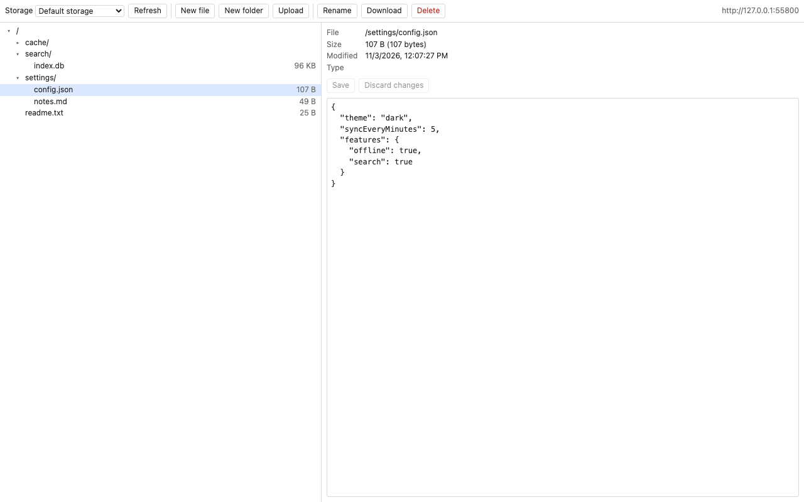
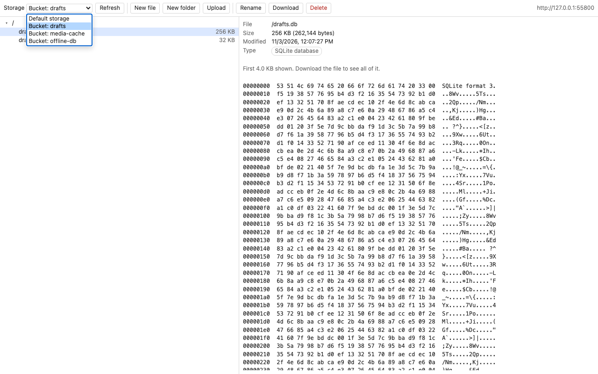
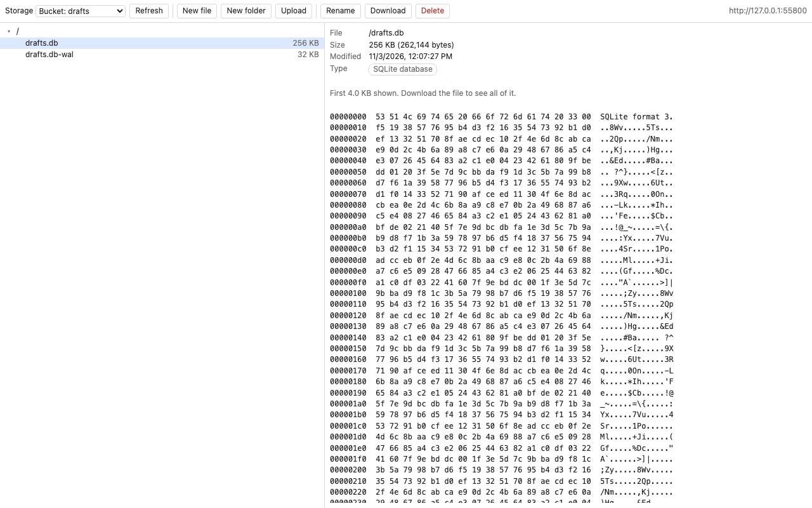
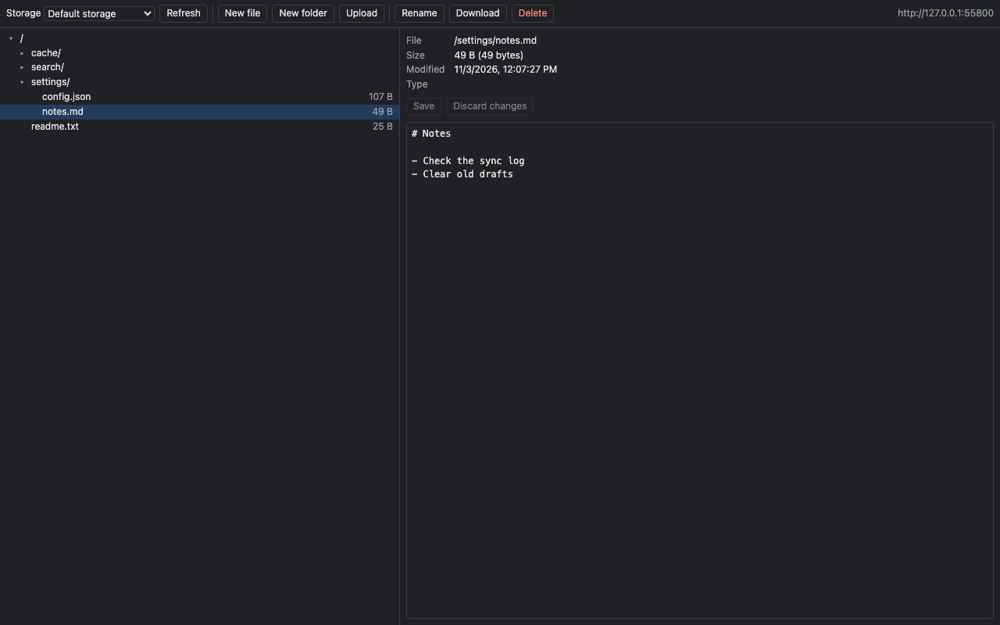

# OPFS Inspector

A developer tools panel for the [origin private file system](https://developer.mozilla.org/en-US/docs/Web/API/File_System_API/Origin_private_file_system) (OPFS) of the page you are inspecting. It shows the default storage and every [Storage Bucket](https://wicg.github.io/storage-buckets/) of the site, and lets you create, rename, edit, delete, upload and download files.









## What it does

- **Storage picker.** Default storage, plus each bucket from `navigator.storageBuckets.keys()` where the browser has Storage Buckets (Chromium-based browsers). A bucket is only opened if it exists, so the panel never creates one.
- **Folder tree.** Folders are read one at a time, when you open them. Only that folder's files are read, for their size and date.
- **Text editor** for UTF-8 files up to 2 MB, with Save and Discard. You cannot leave a file with unsaved changes.
- **Byte view** for other files, with SQLite databases marked as such.
- **New file, new folder, rename, delete, upload, download.** Delete asks first. Upload skips names that already exist.
- **Clear errors**, for example when a database has a file open, or when the browser lost track of the site's files after its data was deleted.

## How it keeps the page light

- Nothing runs in a page until you open the panel for it. There is no content script in the manifest; the panel's first request adds a small listener to the inspected page.
- No file or folder handles are kept between actions. Each action finds its path again from the root. Using a handle from before a site-data deletion can break a site's storage in Chromium ([issue 575150688](https://issues.chromium.org/issues/575150688)), and this avoids it.
- Nothing refreshes by itself. Press Refresh to read the files again.

## Browser support

| | Chrome / Edge | Firefox | Safari |
| --- | --- | --- | --- |
| Browse, edit, rename, delete, upload, download | yes | yes | browse from 16, edit from 26 (writing from a page needs `createWritable`) |
| Storage Buckets | yes | no | no |
| Tested automatically | Chromium 141, Edge 156 | Firefox 142 | not tested, see below |

Storage Buckets exist only in Chromium-based browsers ([caniuse](https://caniuse.com/?search=storageBuckets)). Firefox needs version 128 or later, set in the manifest.

## Try it locally

Chrome or Edge:

1. Open `chrome://extensions` (Chrome) or `edge://extensions` (Edge).
2. Turn on **Developer mode**.
3. Click **Load unpacked** and choose this folder.
4. Open any site that uses OPFS, open the developer tools (F12), and choose the **OPFS** tab. If you don't see it, look under the `»` menu.

Firefox:

1. Open `about:debugging#/runtime/this-firefox`.
2. Click **Load Temporary Add-on…** and choose `manifest.json` in this folder.
3. Open `about:addons`, open OPFS Inspector, and under **Permissions** allow access to all websites. Firefox asks for host access separately.
4. Open the developer tools and choose the **OPFS** tab.

Safari needs the extension wrapped in a macOS app, which needs Xcode. See [PUBLISHING.md](PUBLISHING.md).

## Tests

```sh
npm install
npx playwright install chromium firefox webkit
npm test
```

- `test/ops.test.mjs`: every file operation, in Chromium, Firefox and WebKit.
- `test/ui.test.mjs`: the panel, clicked through like a person, in Chromium and Firefox.
- `test/extension.test.mjs`: the unpacked extension loaded into Chromium and Microsoft Edge, working on a real page's files and bucket. Needs Edge installed; set `ENGINES=chromium` to skip it.

WebKit in Playwright has no working OPFS, so its tests are skipped with the reason. Safari itself has to be checked by hand.

`node scripts/screenshots.mjs` remakes the screenshots above.

`npm run lint:firefox` checks the manifest for Firefox. `npm run package` builds the zip for the stores.

## Files

- `src/ops.js`: the file operations. It runs inside the inspected page and keeps no state.
- `src/agent.js`: answers the panel's requests inside the page.
- `src/background.js`: adds the agent to the page when needed and passes messages.
- `panel.html`, `panel.js`, `panel.css`: the panel.
- `devtools.html`, `devtools.js`: registers the panel.

## License

MIT
