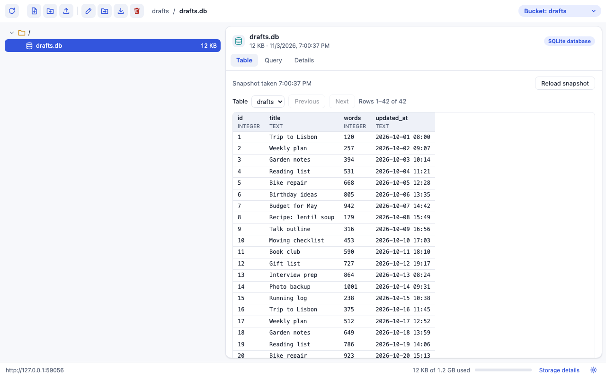
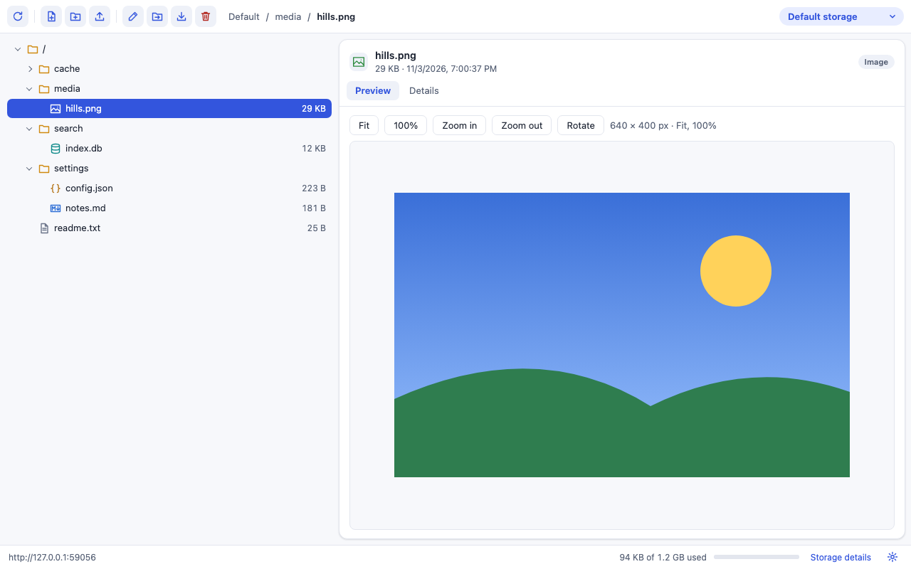

# OPFS Inspector

A developer tools panel for the [origin private file system](https://developer.mozilla.org/en-US/docs/Web/API/File_System_API/Origin_private_file_system) (OPFS) of the page you are inspecting. It shows the default storage and every [Storage Bucket](https://wicg.github.io/storage-buckets/) of the site. You can browse, edit, preview, move and download files, and look inside SQLite databases.







## What it does

New in 0.2.0: a new look, a keyboard tree, a real code editor, previews, and a SQLite viewer.

- **Storage picker.** Default storage, plus each bucket from `navigator.storageBuckets.keys()` where the browser has Storage Buckets (Chromium-based browsers). A bucket is only opened if it exists, so the panel never creates one.
- **File tree.** Folders are read one at a time, when you open them. Each file has a type icon. Use the arrow keys to move, and Ctrl/Cmd+click or Shift+click to pick several items. Large folders stay fast. A path bar shows where you are.
- **Editor** for UTF-8 files up to 2 MB, with syntax colours for JSON, JavaScript, CSS, HTML, Markdown and SQL. Save, Discard and Format JSON. Format JSON keeps every number exactly as written. Firefox before version 135 cannot do this, so there it will not format a file if a number would change. You cannot leave a file with unsaved changes.
- **Previews.** Images, with zoom and rotate. Markdown, shown safely, with no scripts and no outside requests.
- **SQLite viewer.** Open a database file to see its tables, page through rows, and run read-only queries. It works on a copy taken in memory, including changes still in the `-wal` file. A query that takes too long can be cancelled, and it stops by itself after 30 seconds. It never writes to the site's files.
- **File actions.** New file, new folder, rename, duplicate, delete, upload and download. Drag items onto a folder to move them, or use **Move to**. Drop files or folders from your computer to upload them. Several items download as one zip.
- **Folder sizes and storage details**, including how much each bucket uses.
- **Keyboard shortcuts and menus.** Right-click an item for its menu. Press `?` to see every shortcut.
- **Settings** for the JSON indent, key sorting, folder sizes and the editor font size.
- **Clear errors**, for example when a database has a file open, or when the browser lost track of the site's files after its data was deleted.

### What it does not read

The SQLite viewer reads plain database files, meaning files that start with the SQLite header. It does not read pool layouts, such as `opfs-sahpool` from the official SQLite build or wa-sqlite's `AccessHandlePoolVFS`. It does not read databases kept in IndexedDB either. Those files show as bytes. If a site uses `journal_mode` MEMORY or OFF together with exclusive locking, the viewer cannot fully check a copy taken while the site was writing. If the data looks wrong, use **Reload snapshot**.

## How it keeps the page light

- Nothing runs in a page until you open the panel for it. There is no content script in the manifest; the panel's first request adds a small listener to the inspected page.
- No file or folder handles are kept between actions. Each action finds its path again from the root. Using a handle from before a site-data deletion can break a site's storage in Chromium ([issue 575150688](https://issues.chromium.org/issues/575150688)), and this avoids it.
- Nothing refreshes by itself. Press Refresh to read the files again.

## Browser support

| | Chrome / Edge | Firefox | Safari |
| --- | --- | --- | --- |
| Browse, edit, rename, delete, upload, download | yes | yes | browse from 16, edit from 26 (writing from a page needs `createWritable`) |
| Storage Buckets | yes | no | no |
| Tested automatically | Chromium 141, Edge 156 | Firefox 142 | not tested, see below |

Storage Buckets exist only in Chromium-based browsers ([caniuse](https://caniuse.com/?search=storageBuckets)). Firefox needs version 128 or later, set in the manifest.

## Try it locally

Run `npm install && npm run build` first. The panel is bundled into `build/`, which is not in git.

Chrome or Edge:

1. Open `chrome://extensions` (Chrome) or `edge://extensions` (Edge).
2. Turn on **Developer mode**.
3. Click **Load unpacked** and choose this folder.
4. Open any site that uses OPFS, open the developer tools (F12), and choose the **OPFS Inspector** tab. If you don't see it, look under the `»` menu.

Firefox:

1. Open `about:debugging#/runtime/this-firefox`.
2. Click **Load Temporary Add-on…** and choose `manifest.json` in this folder.
3. Open `about:addons`, open OPFS Inspector, and under **Permissions** allow access to all websites. Firefox asks for host access separately.
4. Open the developer tools and choose the **OPFS Inspector** tab.

Safari needs the extension wrapped in a macOS app, which needs Xcode. See [PUBLISHING.md](PUBLISHING.md).

## Tests

```sh
npm install
npx playwright install chromium firefox webkit
npm test
```

- `test/ops.test.mjs`: every file operation, in Chromium, Firefox and WebKit.
- `test/ui.test.mjs`: the panel, clicked through like a person, in Chromium and Firefox.
- `test/extension.test.mjs`: the unpacked extension loaded into Chromium and Microsoft Edge, working on a real page's files and bucket: the editor, the SQLite viewer, drag to move, and some shortcuts. Needs Edge installed; set `ENGINES=chromium` to skip it.

WebKit in Playwright has no working OPFS, so its tests are skipped with the reason. Safari itself has to be checked by hand.

`node scripts/screenshots.mjs` remakes the screenshots above.

`npm run lint:firefox` checks the manifest for Firefox. `npm run package` builds the zip for the stores.

## Files

- `src/ops.js`: the file operations. It runs inside the inspected page and keeps no state.
- `src/agent.js`: answers the panel's requests inside the page.
- `src/background.js`: adds the agent to the page when needed and passes messages.
- `panel.html`, `panel.css`: the panel page.
- `panel/`: the panel source, split into modules. `main.js` starts it.
- `scripts/build.mjs`: bundles and minifies `panel/` into `build/` with esbuild. `build/` is git-ignored.
- `build/sql-wasm.wasm`: the SQLite engine (sql.js), used only by the SQLite viewer.
- `build/THIRD_PARTY.txt`: the licences of the libraries bundled into `build/`.
- `devtools.html`, `devtools.js`: registers the panel.

## License

MIT
